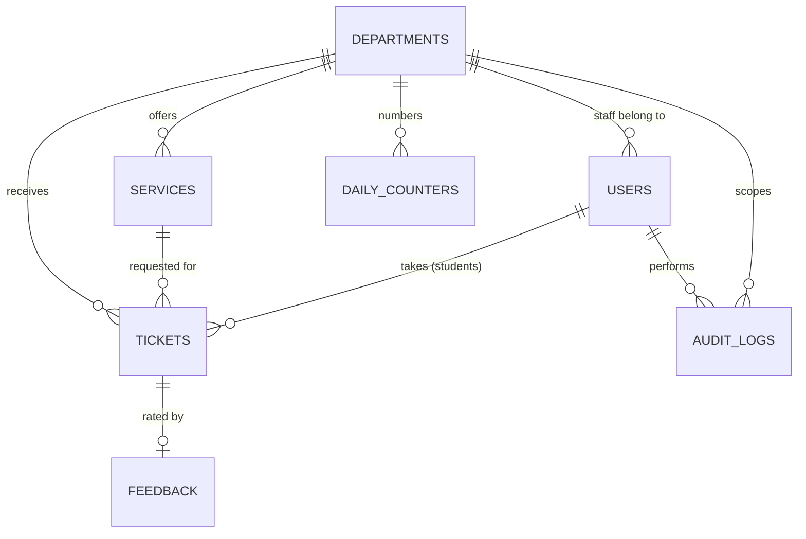

# 04. Database schema

| Version | Schema version | Status | Last updated |
|---------|----------------|--------|--------------|
| 0.4 | 2 (proposed) | Draft | 2026-11-08 |

This is the relational data model for a SQL database: MySQL by default, or MariaDB if that is what the university's hosting provides ([ADR-0001](decisions/ADR-0001-backend-approach.md)). One engine is chosen per deployment, and the schema is not designed to switch engines later. Every change is a Laravel migration, a controlled way to apply schema changes in order.

Field names are written in camelCase here. In the migrations, use Laravel's snake_case (`department_id`, `created_at`) and the standard `id`, `created_at` and `updated_at` columns.

**MVP schema.** The pilot schema includes `departments`, `services`, `users`, `tickets`, `dailyCounters` and `audit_logs`. Admin-managed student and staff accounts use the `users` table. External-identity fields remain future work; items for deferred features are marked below and are added by later migrations when the feature is built.

## Entity relationship diagram

## Entities

### departments

| Field | Type | Rules |
|-------|------|-------|
| id | id | primary key |
| name | text | required, unique |
| prefix | text | required, unique, 2 to 4 capital letters (`RGS`) |
| isActive | boolean | default true. Deactivate instead of delete. |
| opensAt, closesAt | time | local time (Asia/Manila), used by TKT-07. After the MVP. |
| isPaused | boolean | default false (STF-06). After the MVP. |
| createdAt | timestamp | |

### services

| Field | Type | Rules |
|-------|------|-------|
| id | id | primary key |
| departmentId | id | foreign key to departments, required |
| name | text | required, unique within the department |
| isActive | boolean | default true |
| defaultMinutes | integer | fallback estimate when there is no history (default 5). After the MVP. |

### users

The `password` column holds a hash only when the configured authentication mode uses local passwords. For local accounts, the app generates a temporary password, shows it once after creation/reset, and requires a change at first sign-in; admins cannot choose or retrieve it later. An external identity maps to a local user using a provider name and stable provider subject; email alone is not a durable external identity key. See [ADR-0003](decisions/ADR-0003-account-provisioning-and-identity.md).

| Field | Type | Rules |
|-------|------|-------|
| id | id | primary key |
| role | enum | `student`, `staff`, `admin` |
| fullName | text | required |
| email | text | required, unique (university email) |
| idNumber | text | student ID, required for students, unique |
| course | text | students only, from the university records |
| departmentId | id | required when role is `staff`, otherwise empty |
| identityProvider | text | nullable provider key for an external identity |
| externalSubject | text | nullable stable subject from that provider; unique with identityProvider |
| isActive | boolean | default true |
| mustChangePassword | boolean | default false; temporary local credentials require a change before other authenticated routes |
| password | text | nullable hash; never store the temporary password as plaintext |
| createdAt | timestamp | |

When external identity is configured, `identityProvider` and `externalSubject` are either both null or both present. Add a unique constraint across the pair; email remains a contact/lookup field, not the external identity key.

### tickets

| Field | Type | Rules |
|-------|------|-------|
| id | id | primary key |
| departmentId | id | foreign key, required |
| serviceId | id | foreign key, required, must belong to departmentId |
| studentId | id | foreign key, empty only for guest tickets (AUTH-06, deferred past the MVP) |
| queueDate | date | `YYYY-MM-DD` in Asia/Manila, set by the system |
| number | integer | from the daily counter, 1 and up |
| code | text | stored, `RGS-007` (prefix at creation time) |
| status | enum | `waiting`, `serving`, `completed`, `cancelled`, `skipped`. All five are used in the MVP. |
| priority | enum | `normal` or `priority` (STF-07, default `normal`). After the MVP. |
| counterLabel | text | set when called (STF-05). After the MVP. |
| createdAt | timestamp | when taken |
| calledAt | timestamp | when status became `serving` |
| completedAt | timestamp | when `completed` or `skipped` |
| cancelledAt | timestamp | set when a ticket is cancelled (TKT-06) |
| handledBy | id | staff user who called it |

Constraints:
- Unique (departmentId, queueDate, number).
- At most one ticket per student with status `waiting` or `serving` (TKT-04). MySQL and MariaDB have no partial unique index, so this is enforced inside the create-ticket transaction by locking the student's `users` row before checking.
- Allowed status changes follow the table in [03](03-architecture.md).

### dailyCounters

| Field | Type | Rules |
|-------|------|-------|
| departmentId, queueDate | id, date | together unique: one row per department per day |
| lastNumber | integer | starts at 0, increases by 1 per ticket |

### feedback

Deferred past the MVP. Created by a later migration.

| Field | Type | Rules |
|-------|------|-------|
| id | id | primary key |
| ticketId | id | foreign key, unique (one rating per ticket) |
| studentId | id | foreign key |
| departmentId | id | copied from the ticket for easy filtering |
| rating | integer | 1 to 5 |
| comment | text | optional, max 500 characters |
| createdAt | timestamp | |

### audit_logs

Required for the MVP (ADM-08). Insert audit records in the same transaction as the successful business operation they describe. The application provides no update or delete action for audit records.

| Field | Type | Rules |
|-------|------|-------|
| id | id | primary key |
| actorId | id | nullable user foreign key; null for an automated/system action |
| action | text | business event such as `student.created`, `ticket.called`, or `service.updated` |
| targetType, targetId | text, id | type and identifier of the changed record |
| departmentId | id | nullable department context |
| metadata | JSON | nullable; reserved for deliberately allow-listed non-sensitive details, never passwords, tokens, session data, or full request bodies |
| createdAt | timestamp | indexed for chronological filtering |

Use an index on `(createdAt, id)` and useful actor/department/action filters. The retention period and archival policy must be agreed with the university before real data is used.

## Atomic operations

These must happen in one indivisible step: a database transaction with row locks (InnoDB), for example Laravel's `DB::transaction` with `lockForUpdate()`:

1. **Create ticket:** lock the student's `users` row and check they have no `waiting` or `serving` ticket (TKT-04). Make sure the day's counter row exists (its unique key prevents two copies), lock it, add 1, write the counter, and write the ticket with that number. The MVP also checks that the department is active. Open-hours and pause checks come later (TKT-07, STF-06).
2. **Call next:** find and lock the oldest `waiting` ticket in the staff member's department (priority first once STF-07 exists), set it to `serving` with `calledAt` (and the counter label once STF-05 exists). Two staff pressing at once must get different tickets, and a ticket that is already `serving` is never called again.
3. **Cancel, complete, skip, recall:** lock the ticket, check the current status, then change it. The MVP uses cancel, complete, skip and recall.

Derived numbers (not stored):
- **People ahead** = waiting tickets in the same department and day with a smaller number.
- **Estimated wait** = people ahead x average service time of the last 10 completed tickets in that department (fallback: `defaultMinutes`). After the MVP.
- **Average wait** = `calledAt - createdAt`. **Average service time** = `completedAt - calledAt`.

## Access matrix

Enforce this on the server with Laravel policies and department-scoped queries. Hiding a button is not enough.

| Data | Public screen | Student | Staff | Admin |
|------|---------------|---------|-------|-------|
| departments, services (read) | read | read | read | read |
| departments, services (write) | no | no | no | write |
| users | no | own record | own record | read and write |
| tickets: read | board fields only | own tickets | own department | all |
| tickets: create | no | own, rules above | no | no |
| tickets: cancel | no | own, while `waiting` | own department | no |
| tickets: call, complete, skip, recall | no | no | own department | no |
| feedback | no | create for own completed ticket, read own | no | read all |
| dailyCounters | no | no | no | no (changed only through ticket creation) |
| stats | no | no | own department | all |
| activity log | no | no | no | read only; system inserts |

"Board fields only" means ticket code, status, counter label (once it exists) and department, with no student identity. The public display uses a read-only response that never includes student fields. The `feedback` and `stats` rows apply once those features are built (after the MVP). Audit logs are admin-readable; they do not grant admins additional permission to alter ticket or account data.

## Changes from the old schema

| Old | New | Why (audit ref) |
|-----|-----|-----------------|
| `user_account_register` with roles `student`, `employee`, `admin` | `users` with `student`, `staff`, `admin` and `departmentId` | C4, C7, D6 |
| `queue.queue_number` int, global per department | `tickets.number` per department per day, unique | C5, C6 |
| no timestamps beyond `created_at` | `calledAt`, `completedAt`, `cancelledAt` | D5 |
| `feedback.user_id` varchar, `queue_number` varchar | `feedback.ticketId`, `studentId` with the right types | D1, D2 |
| few foreign keys | foreign keys everywhere | D3 |
| code rebuilt at display time | `tickets.code` stored | D4 |
| deleting users and departments | `isActive` flags | ADM-06 |

## Seed data (fake only)

- Departments in scope for now (the enrollment process): Admission (AMS), Registrar (RGS), Accounting (ACC). The pilot starts with one of them (TODO(you): which). Library (LIB) and NU Exchange (EXC) from the old data are not in scope for now.
- Services, taken from the old data: Admission: Application Processing, Entrance Exam Scheduling. Registrar: Enrollment, Transcript Request. Accounting: Scholarship Processing, Tuition Payment. TODO(you): confirm with each office, and add or rename services to match the enrollment process.
- 1 demo admin, 1 demo staff per department, and a few demo students, each with a fake name, student ID, university-style email (`example.com` only) and course. Never import data from the old dump. Real student records, if the pilot uses them, are loaded onto the server by the university and never committed to the repository.

## Schema versioning

Increase the schema version in this file's header whenever the model changes. Record each change below with a migration note (what to do with existing data). Each schema change is a new Laravel migration committed with the code. Never edit a migration that has already run on a shared database; add a new one. Migrations are a controlled way to apply changes, not a guarantee that a change is easy to undo, so back up the database before running them in production.

| Schema | App version | Change | Migration |
|--------|-------------|--------|-----------|
| 1 | 0.1.0 | Initial model | initial migrations, no existing data |
| 2 (proposed) | planned | Add external identity mapping and append-only `audit_logs`; admin-provisioned student accounts | New Laravel migration; retain existing local users and leave external identity fields null. Implement only after reviewing the data-migration plan. |
